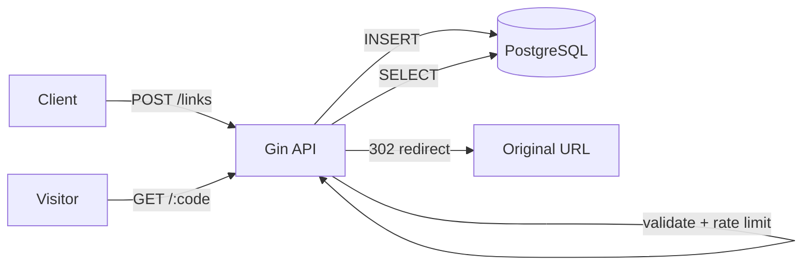

# URL Shortener


A small, security-conscious URL shortener REST API written in Go. It takes a long URL, returns a short code, and redirects visitors from the short link to the original address. Links expire after 24 hours.

I built this as a hands-on project to refresh my Go fundamentals and practice the full path from an empty folder to a containerized service: routing, validation, concurrency, persistence, basic security hardening, and Docker.

## Features

- Create short links with `POST /links` and redirect with `GET /:code`
- Random 6-character codes generated with `crypto/rand` (not guessable), with automatic retry on collision
- Automatic link expiration (`410 Gone` after 24 hours)
- PostgreSQL storage via `pgx` with a connection pool
- Per-IP rate limiting on link creation
- Strict input validation (see [Security](#security))
- Runs fully in Docker: app, database, and pgAdmin with one command

## Tech stack

| Area | Choice |
|---|---|
| Language | Go 1.25 |
| HTTP framework | [Gin](https://github.com/gin-gonic/gin) |
| Database | PostgreSQL 17 ([pgx v5](https://github.com/jackc/pgx)) |
| Rate limiting | `golang.org/x/time/rate` |
| Config | Environment variables, `.env` via [godotenv](https://github.com/joho/godotenv) |
| Containers | Docker, Docker Compose (multi-stage build) |

## How it works



## Quick start

**Requirements:** Docker with Docker Compose. (Go is only needed if you want to run the app outside Docker.)

```bash
git clone https://github.com/hamidabbaci/url-shortener.git
cd url-shortener

cp .env.example .env
# open .env and replace every "change_me" with your own passwords
# (keep the password in DATABASE_URL equal to POSTGRES_PASSWORD)

docker compose up -d --build
```

The API is now available at `http://localhost:8080` and pgAdmin at `http://localhost:5050`. Both ports are bound to `127.0.0.1` only, so they are not exposed to your network.

The `links` table is created automatically on the first start from [`db/init.sql`](db/init.sql).

### Try it

```bash
# Create a short link
curl -X POST http://localhost:8080/links \
  -H "Content-Type: application/json" \
  -d '{"url": "https://github.com"}'
```

```json
{"short_code":"aB3x9K","short_url":"http://localhost:8080/aB3x9K"}
```

Open the `short_url` in a browser and you are redirected to the original address.

### Run without Docker for the app

```bash
docker compose up -d db     # start only the database
go run .                    # reads configuration from .env
```

## API

| Method | Path | Description |
|---|---|---|
| `GET` | `/health` | Health check, returns `{"status":"ok"}` |
| `GET` | `/ping` | Returns `{"message":"pong"}` |
| `POST` | `/links` | Create a short link. Body: `{"url": "https://..."}` |
| `GET` | `/:code` | Redirect (`302`) to the original URL |

### Status codes

| Code | When |
|---|---|
| `201 Created` | Short link created |
| `302 Found` | Redirecting to the original URL |
| `400 Bad Request` | Missing or invalid URL |
| `404 Not Found` | Unknown or malformed code |
| `410 Gone` | Link has expired |
| `429 Too Many Requests` | Rate limit exceeded |
| `500 Internal Server Error` | Unexpected error (details are logged, not returned) |

## Configuration

| Variable | Description | Default |
|---|---|---|
| `PORT` | Port the API listens on | `8080` |
| `BASE_URL` | Base address used to build `short_url` | `http://localhost:<PORT>` |
| `DATABASE_URL` | PostgreSQL connection string | required |
| `POSTGRES_USER`, `POSTGRES_PASSWORD`, `POSTGRES_DB` | Database credentials for the `db` container | required |
| `PGADMIN_EMAIL`, `PGADMIN_PASSWORD` | pgAdmin login | required |

See [`.env.example`](.env.example) for a template. The real `.env` file is git-ignored.

## Security

This project applies the following measures:

- **Input validation:** only `http`/`https` URLs, maximum 2048 characters, no embedded credentials (`user:pass@host`), and no `localhost` or private/loopback IP targets. Request bodies are capped at 4 KB.
- **SQL injection:** all queries use parameterized statements.
- **Unpredictable codes:** generated with `crypto/rand`.
- **Rate limiting:** 1 request per second per IP, burst of 5, on `POST /links`. Stale entries are cleaned up automatically. Forwarded-IP headers are not trusted, so the limit cannot be bypassed by spoofing `X-Forwarded-For`.
- **Server hardening:** read/write/idle timeouts against slow-connection attacks, database query timeouts, and graceful shutdown.
- **Response headers:** `X-Content-Type-Options`, `X-Frame-Options`, `Referrer-Policy`.
- **Secrets:** read from environment variables; `.env` is git-ignored and excluded from the Docker image.
- **Containers:** the app runs as a non-root user from a minimal Alpine image, and database/pgAdmin ports are bound to `127.0.0.1`.

## Project structure

```
.
├── main.go                  # routes, validation, server setup
├── store/
│   ├── code.go              # random code generation
│   ├── models.go            # Link model and errors
│   └── store.go             # PostgreSQL storage
├── middleware/
│   ├── ratelimit.go         # per-IP rate limiter
│   └── headers.go           # security headers
├── db/init.sql              # table creation on first start
├── Dockerfile               # multi-stage build
├── docker-compose.yml       # app + PostgreSQL + pgAdmin
└── .env.example
```

## Roadmap

- [ ] Unit and integration tests
- [ ] Schema migrations (e.g. golang-migrate)
- [ ] Background job to delete expired links
- [ ] Click statistics per link
- [ ] Authentication and per-user links
- [ ] Custom aliases and configurable expiry
- [ ] HTTPS behind a reverse proxy for deployment

## Author

**Hamidreza Abbasi** · [GitHub](https://github.com/hamidabbaci)
